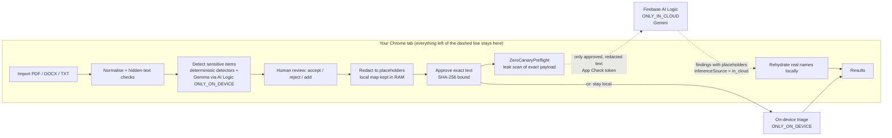

# ClauseGuard Hybrid

**A privacy airlock for confidential documents. Chrome's on-device Gemma reads the document and finds what is sensitive; you approve the exact redacted text, byte for byte; only then does a cloud Gemini model reason about it. Real names, IBANs and amounts are put back locally, in your browser.**

Built for **#BuildHybridAI 2026** (Web / Chrome track) with **Firebase AI Logic hybrid inference**: the same SDK drives both the on-device model (`InferenceMode.ONLY_ON_DEVICE`) and the cloud model (`InferenceMode.ONLY_IN_CLOUD`), and the app checks `inferenceSource` on every response to prove which one answered.

- Licence: [Apache-2.0](./LICENSE)
- Hosted demo URL: **not deployed yet** (see [docs/deploy.md](docs/deploy.md); the owner fills this in: `TODO`)
- Demo video: `TODO` (script: [docs/demo-script.md](docs/demo-script.md))
- Devpost text: [docs/devpost-text.md](docs/devpost-text.md)

---

## 1. Problem and audience

People are told to "just ask an AI" about documents that are full of things they must not leak: a tenant with a lease, a patient with a hospital bill, a founder with an MSA, a procurement reviewer with a DPA. Pasting the raw document into a cloud chatbot ships counterparty names, IBANs, tax IDs, patient IDs and deal pricing off the device *before* anyone has decided that is acceptable.

ClauseGuard is for those people: individuals checking a lease or a medical bill, and small legal / procurement / finance teams reviewing contracts. The point is not "AI that is private by policy". The point is a flow where **the cloud physically never receives the raw text, and the person can see exactly what it does receive.**

## 2. The four-step flow

The UI is a four-step stepper (`index.html`, `src/ui/app.ts`):

| Step | What the user does | What happens |
|---|---|---|
| **1. Import** | Drop a PDF / .docx / .txt / .md, or pick a made-up sample (tenant lease, medical bill, business services agreement, data-processing agreement, adversarial-injection sample) | Parsed in browser memory (`src/core/ingestion/`): NFKC normalisation, invisible-character stripping, homoglyph and hidden-text flags, local PDF/DOCX parsing. Nothing is uploaded. |
| **2. Review** | Accept or reject each detected item; add your own words to hide ("Hide it everywhere") | Entities come from deterministic detectors + the on-device model via `ONLY_ON_DEVICE`. Each starts as pending; you decide. |
| **3. Approve** | Read the exact cleaned text under "What leaves your device", tick the consent box, press **Approve this exact text** | An immutable approval record is bound to the SHA-256 of that exact payload. Any later edit invalidates it (`STALE_APPROVAL_INVALIDATED`). `ZeroCanaryPreflight` re-scans the payload for leaks. |
| **4. Results** | Press **Run the deeper check**; read risks with real names restored | Cloud Gemini runs via `ONLY_IN_CLOUD` on the approved text only; placeholders are rehydrated locally. **Check on this device only** keeps everything local. |

## 3. Where Firebase AI Logic hybrid inference is used (runtime code paths)

Imports are from `firebase/ai` (`getAI`, `getGenerativeModel`, `InferenceMode`, `InferenceSource`, `GoogleAIBackend`) plus `firebase/app-check`.

| Role | Mode | Code | Runtime check |
|---|---|---|---|
| On-device extraction and local clause triage of **raw** text | `InferenceMode.ONLY_ON_DEVICE` | [`src/core/firebase/firebaseClient.ts`](src/core/firebase/firebaseClient.ts) (`getGenerativeModel(... mode: InferenceMode.ONLY_ON_DEVICE ...)`, lines ~224-281), called from [`src/core/orchestration/nanoAdapter.ts`](src/core/orchestration/nanoAdapter.ts) | `result.response.inferenceSource === InferenceSource.ON_DEVICE` (nanoAdapter.ts ~571); anything else is rejected |
| Model download/prepare | `model.initializeDeviceModel(onProgress)` | nanoAdapter.ts ~372, behind the "Set up private AI" button (user gesture) | progress shown in the status bar |
| Cloud reasoning on the **approved, redacted** payload | `InferenceMode.ONLY_IN_CLOUD` | firebaseClient.ts ~419-433, called from [`src/core/inference/approvalMachine.ts`](src/core/inference/approvalMachine.ts) | `inferenceSource === InferenceSource.IN_CLOUD` (approvalMachine.ts ~328); mismatch throws |
| App Check | `ReCaptchaEnterpriseProvider` (debug token on localhost only) | firebaseClient.ts ~373-396 | `initializeAppCheck` runs **before** `getAI` (recorded in an `initSequence`, unit-tested) |
| Remote Config | guarded | [`src/core/firebase/remoteConfigGuard.ts`](src/core/firebase/remoteConfigGuard.ts) | only `cloud_model_name`, `playbook_id`, `max_cloud_output_tokens` are tunable; values that would weaken approval, preflight or App Check are rejected |

Design choices worth knowing:

- **No `PREFER_ON_DEVICE` for raw text.** That mode silently falls back to the cloud, which is exactly the leak this app exists to prevent. Raw text uses `ONLY_ON_DEVICE` and, if the model is unavailable, fails closed to a deterministic local path labelled `DEGRADED_DETERMINISTIC_SAFE`. The on-device model objects are also created with an unroutable `baseUrl` (`http://127.0.0.1:0/only-on-device-cloud-egress-blocked`) as defence in depth.
- **`inferenceSource` is surfaced in the UI**: Results show `Source: ... | sdk:on_device` or `sdk:in_cloud`, and "Under the hood" shows "Last observed source".
- Cloud models are allow-listed in code: `gemini-3.5-flash-lite` (default), `gemini-3.8-flash`, `gemini-4-hydrogen`.
- If no cloud credentials are configured (or you tick the practice-mode box), the app runs a clearly labelled `SIMULATED_CLOUD_SYNTHESIS` with zero packets. It is never presented as real cloud output.

## 4. Architecture



Source map: ingestion `src/core/ingestion/`, detection `src/core/detection/`, redaction `src/core/redaction/`, approval and cloud call `src/core/inference/approvalMachine.ts`, Firebase `src/core/firebase/`, on-device adapter `src/core/orchestration/nanoAdapter.ts`, orchestration `src/core/sessionController.ts`, UI `src/ui/`, optional AES-GCM entity vault `src/core/storage/encryptedVault.ts`.

## 5. Privacy guarantees and how each is proven

Everything below is backed by a file in [`evidence/`](evidence/) or a unit test. Read the "not covered" column; it is part of the claim.

| Guarantee | Proof | Not covered |
|---|---|---|
| Importing and reviewing a document sends **nothing** anywhere | [`phase6-cdp-egress-and-security-proof.json`](evidence/phase6-cdp-egress-and-security-proof.json): Playwright + Chrome DevTools Protocol, 11 scenarios all PASS, 0 unexpected external requests, 0 raw canary strings in cloud POST bodies, URLs or console | Run against a **local mock** of the Gemini endpoint (the file says so). No real Google request was made by that script. |
| Cloud call is blocked until approval, and approval is bound to the exact text | Same file, scenarios 02-04: sent SHA-256 equals approved SHA-256; an edit after approval gives `STALE_APPROVAL_INVALIDATED` and the call is blocked (`ERR_UNAPPROVED_EGRESS_BLOCKED`); wire path is `...:generateContent` with `X-Firebase-AppCheck` present and `inferenceSource: in_cloud`. Unit tests in `tests/unit/` | Mock cloud, as above |
| Gemma on-device really ran, with the network off | [`wo062-live-on-device-proof.json`](evidence/wo062-live-on-device-proof.json): Chrome 158.0.8127.36 on Linux, `LanguageModel.availability()` = `available`, badge `READY_ON_DEVICE`, two samples processed, **0 external requests across all phases**, an offline run (`navigator.onLine=false`) completed using the on-device model | No live cloud call (stated in `not_covered`). Proves the runtime path and egress, **not** Gemma's recall. The model added 1 entity on the lease sample and 0 on the medical bill; deterministic detectors found the rest. |
| Fails closed when the model is unavailable | phase6 scenarios 01 and 10 (`DEGRADED_DETERMINISTIC_SAFE`, model-disabled fail-closed) | |
| Hostile documents (hidden characters, prompt injection, XSS) are handled | phase6 scenario 07 (`xss_executed: false`, invisible Unicode stripped, injection pattern flagged) | Synthetic attacks only |
| Redaction is lossless | [`cg-bench-v2-results.json`](evidence/cg-bench-v2-results.json): 42/42 documents round-trip exactly, 0 substring corruptions | Synthetic corpus |
| Entity detection quality (honest numbers) | Same file, 42 synthetic contracts, 250 labelled mentions, best variant `ARCH-RET-4.1`: precision 0.9909, recall 0.8720, F2 0.8934 (218 TP, 2 FP, 32 FN) | **Synthetic data we wrote ourselves; recall is not 100%, so the human review step matters.** This measures the deterministic detector, not Gemma. |
| Chrome Prompt API behaviour, token budgets | [`phase2-nano-runtime-matrix.json`](evidence/phase2-nano-runtime-matrix.json): 14-experiment matrix on Chrome 156 | Older Chrome; superseded for readiness by the wo062 file |
| Remote Config cannot weaken privacy | `tests/unit/firebase_hardening.test.ts` | |

A real (non-mock) Firebase AI Logic cloud call from this repo is **not recorded in the evidence files**. Earlier commit messages mention a live call; treat it as unverified until you re-run it and save the output (see Limitations).

## 6. Run and test

Requirements: Node.js 20+ (22 recommended), Chrome desktop. The Python probes need Python 3 and Playwright.

```bash
npm ci
npm run typecheck
npm test
npm run build
npm run dev        # http://localhost:4173 (Vite, strict port)
```

Browser-level privacy suites (build first; they drive a real Chrome):

```bash
npm run build && python3 tests/e2e_cdp_privacy_verify.py   # writes evidence/phase6-...json (mock cloud)
python3 tests/e2e_live_on_device_verify.py                  # needs Gemma weights in the probe profile; writes evidence/wo062-...json
python3 probes/nano_runtime_probe.py                        # Prompt API readiness matrix
npm run bench                                               # CG-BENCH-v2 (deterministic detector)
```

Without Gemma installed the app still works: it shows an honest readiness badge and uses deterministic local detection. Without Firebase credentials the cloud step is practice mode (labelled, zero packets).

## 7. Gemma 4 on-device setup (honest hardware notes)

Chrome's built-in AI (Prompt API, Gemma 4 component) is what runs on-device. **This repo does not contain or redistribute model weights.** Chrome (or the helper below) downloads Google's own signed component from Google's update servers.

1. In `chrome://flags` enable *Prompt API for Gemini Nano*, its multimodal-input variant, *Enables optimization guide on device* (`Enabled BypassPerfRequirement`), and *Gemma 4 for Built-in AI* if your build lists it. Restart Chrome. Inspect `chrome://on-device-internals`.
2. Click **Set up private AI** in the app (calls `initializeDeviceModel`). On the tested Chrome 158 the component downloaded by itself in about 6.5 minutes (per the note in the installer script).
3. If Chrome's updater fails (Chrome 156 hit an int32 size overflow on the ~2.3 GiB component), use the fallback installer, which fetches the official Omaha-listed `.crx3`, verifies its SHA-256, and extracts it into a Chrome profile:

```bash
python3 probes/install_chrome_on_device_model.py --probe-only            # inspect only
python3 probes/install_chrome_on_device_model.py --probe-profile-only    # install into the ClauseGuard probe profile only
```

Hardware actually tested (from the evidence files): Linux x86_64, 16 logical cores, 14.5 GiB RAM, NVIDIA RTX 2050 laptop GPU, run with `BypassPerfRequirement`. The weights file is about 2.3 GiB; budget several GiB of disk. Other machines, other OSes, and low-RAM or no-GPU devices are **untested**; Chrome may report the model `unavailable` and ClauseGuard then stays in the safe deterministic mode. Note that Chrome 158 once reported `unavailable` with the same profile before the final run succeeded, so availability can vary by profile state.

## 8. Firebase setup and deployment

- Firebase project, AI Logic, App Check, Remote Config: [docs/firebase-setup.md](docs/firebase-setup.md). Run `node scripts/verify_firebase.mjs` for an offline sanity check. No secrets are in the repo; `.env.local` is git-ignored and `.env.example` shows the variables.
- Hosting (Firebase Hosting primary, Render static mirror): [docs/deploy.md](docs/deploy.md). Nothing is deployed by this repo.
- Public web config values ship in the bundle by design; App Check, not secrecy of those IDs, protects the backend.

## 9. Limitations (read these)

- **Not legal or medical advice.** Output is a first-pass risk flag, not a review by a professional.
- Detection is not perfect (recall 0.872 on our own synthetic corpus). The review step exists because of that; a missed item you do not add will be sent.
- On-device Gemma improved entity finding on one of two samples in the live proof; most detection is deterministic. We make no accuracy claim for Gemma.
- Live cloud inference is covered only against a mock in the committed evidence. Re-run once against the real Firebase project and save the result before claiming it.
- On-device results depend on Chrome version, flags, hardware and profile state; tested on one Linux machine, Chrome 156 and 158.
- Digital PDFs only (no OCR); PDF page limit enforced (`ERR_PDF_PAGE_LIMIT`).
- The optional vault uses AES-GCM in the browser with a user passphrase; it has not had an external security review.
- Deterministic redaction is by exact surface strings and patterns; paraphrased references to a person ("the landlord's CEO") can survive.
- No usage data exists: the project has not been tested with real users.

## 10. Hackathon disclosures

Pre-existing work: the repo history begins 2026-11-17, inside the submission period (Nov 11 - Nov 30, 2026), but the project grew out of an earlier research prototype in a wider monorepo (the history references earlier phases). The owner should state this plainly on Devpost; see [docs/devpost-text.md](docs/devpost-text.md). AI coding assistants were used. Standard open-source libraries are used under their own licences (Firebase JS SDK, pdf.js, JSZip, Vite, Vitest, TypeScript).

## 11. Licence

[Apache License 2.0](./LICENSE). Copyright holder in the licence header: add your name/team before publishing (`TODO`).
